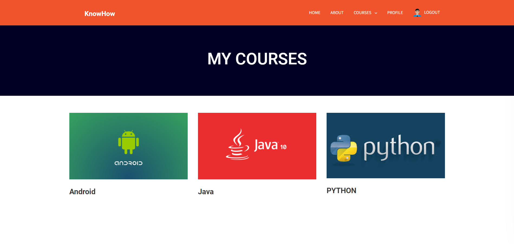
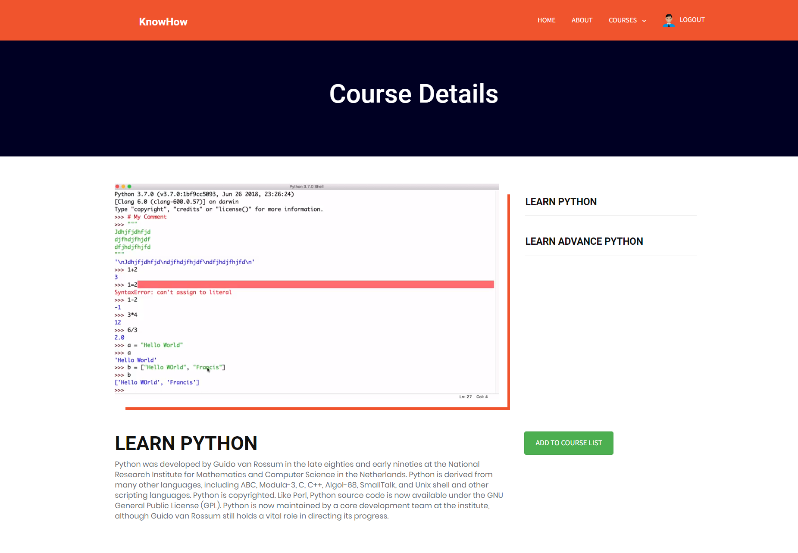
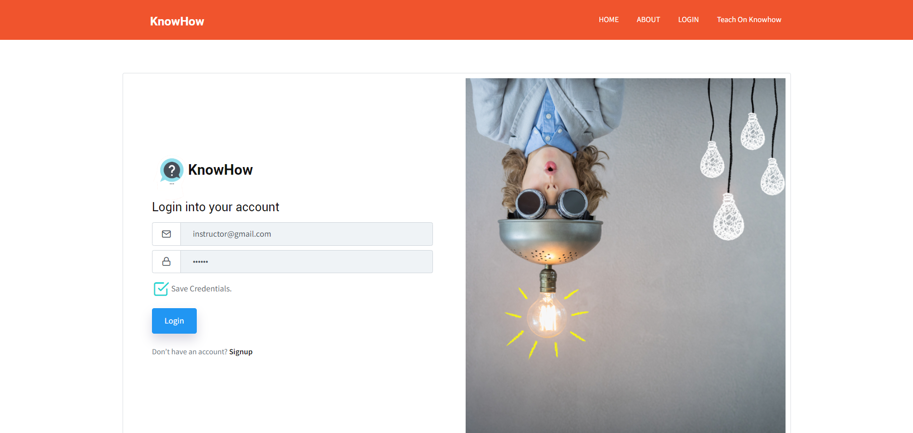
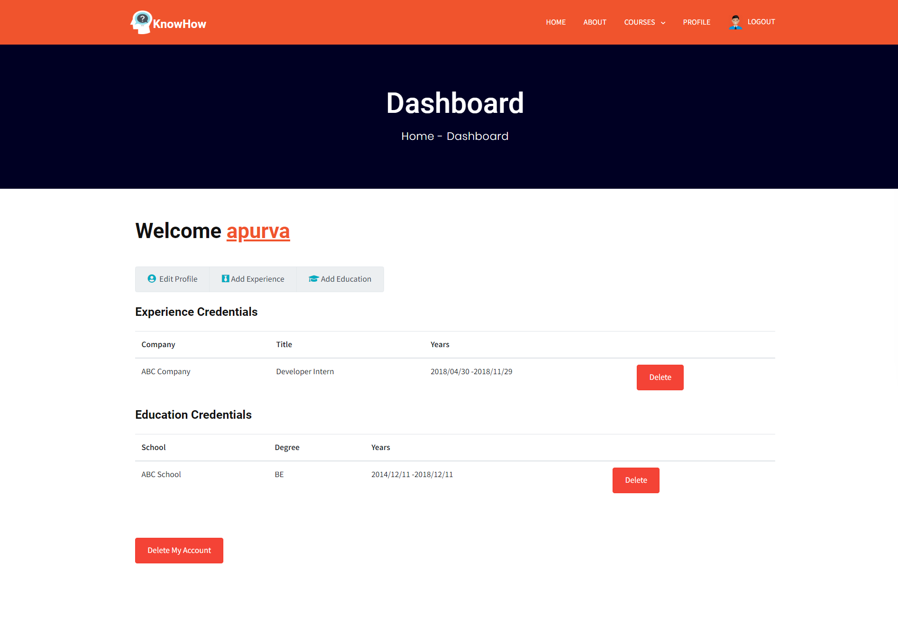
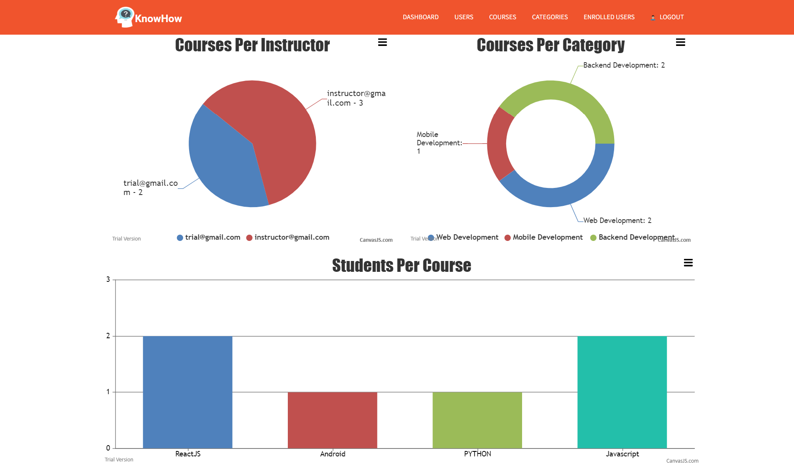
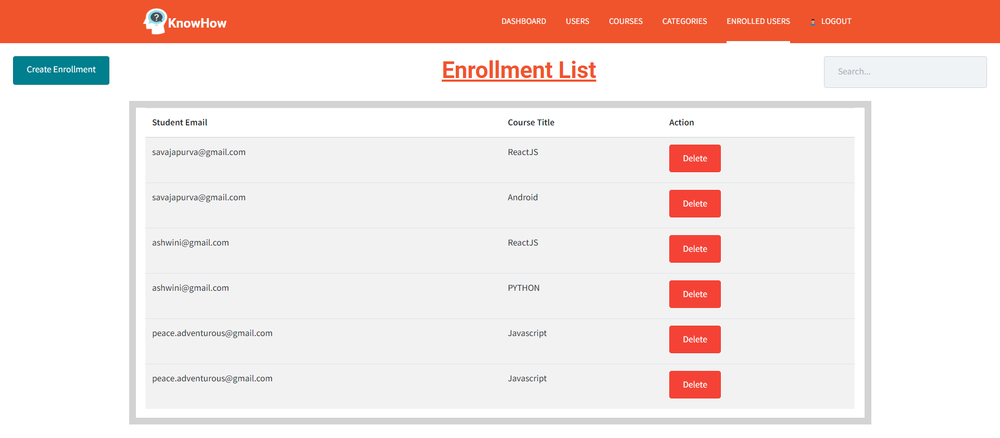

# KnowHow - Advanced E-Learning Platform | MERN Stack

<div align="center">
  
  
  [](https://opensource.org/licenses/MIT)
  [](https://nodejs.org/)
  [](https://reactjs.org/)
  [](https://www.mongodb.com/)
</div>

## 🎓 About

KnowHow is a comprehensive e-learning platform built with the MERN stack, designed to provide seamless online education experiences. The platform supports multiple user roles and offers a complete course management system with video-based learning modules.

### ✨ Key Features

- **👥 Multi-Role Authentication System**
  - Students: Course enrollment and progress tracking
  - Instructors: Course creation and student management
  - Admins: Platform-wide control and analytics

- **📚 Course Management**
  - Create and organize courses by categories
  - Upload and manage video lectures
  - Track student progress and completion

- **🎥 Interactive Learning**
  - YouTube API integration for video content
  - Responsive video player
  - Lecture-based course structure

- **📊 Analytics Dashboard**
  - Student enrollment statistics
  - Course performance metrics
  - User activity tracking

- **🔐 Security Features**
  - JWT-based authentication
  - Password encryption with bcrypt
  - Role-based access control

## 🛠️ Tech Stack

### Frontend
- **React 16+** - Component-based UI library
- **Redux** - State management
- **Bootstrap 4** - Responsive CSS framework
- **Axios** - HTTP client for API calls
- **React Router** - Navigation and routing

### Backend
- **Node.js** - JavaScript runtime
- **Express.js** - Web application framework
- **MongoDB** - NoSQL database
- **Mongoose** - MongoDB object modeling
- **Passport.js** - Authentication middleware
- **JWT** - JSON Web Token authentication

### Additional Libraries
- **Multer** - File upload handling
- **CORS** - Cross-origin resource sharing
- **Canvas.js** - Data visualization
- **Nodemailer** - Email notifications

## 🚀 Quick Start

### Prerequisites
- Node.js (v14 or higher)
- MongoDB (local installation or MongoDB Atlas)
- npm or yarn package manager

### Installation

1. **Clone the repository**
   ```bash
   git clone https://github.com/madurangaPrabhath/E-Learning-MERN.git
   cd E-Learning-MERN
   ```

2. **Install backend dependencies**
   ```bash
   npm install
   ```

3. **Install frontend dependencies**
   ```bash
   cd client
   npm install
   cd ..
   ```

4. **Configure environment variables**
   
   Create/update `config/keys.js`:
   ```javascript
   module.exports = {
     mongoURI: 'mongodb://localhost:27017/elearning', // or your MongoDB Atlas URI
     secretOrKey: 'your-secret-key-here'
   };
   ```

5. **Run the application**
   
   **Development mode (runs both frontend and backend):**
   ```bash
   npm run dev
   ```
   
   **Backend only:**
   ```bash
   npm run server
   ```
   
   **Frontend only:**
   ```bash
   npm run client
   ```

6. **Access the application**
   - Frontend: `http://localhost:3000`
   - Backend API: `http://localhost:5000`

## 📱 Application Screenshots

### Student Portal
<div align="center">
  
  
</div>

### Instructor Portal
<div align="center">
  
  
</div>

### Admin Dashboard
<div align="center">
  
  
</div>

## 🔧 API Endpoints

### Authentication
- `POST /api/users/register` - User registration
- `POST /api/users/login` - User login
- `GET /api/users/current` - Get current user

### Courses
- `GET /api/courses` - Get all courses
- `POST /api/courses` - Create new course (Instructor/Admin)
- `GET /api/courses/:id` - Get course by ID
- `PUT /api/courses/:id` - Update course (Instructor/Admin)
- `DELETE /api/courses/:id` - Delete course (Admin)

### Categories
- `GET /api/categories` - Get all categories
- `POST /api/categories` - Create category (Admin)
- `PUT /api/categories/:id` - Update category (Admin)
- `DELETE /api/categories/:id` - Delete category (Admin)

### Enrollment
- `POST /api/enrollment` - Enroll in course
- `GET /api/enrollment/user/:userId` - Get user enrollments
- `GET /api/enrollment/course/:courseId` - Get course enrollments

## 🏗️ Project Structure

```
E-Learning-MERN/
├── client/                 # React frontend
│   ├── public/            # Static files
│   ├── src/
│   │   ├── components/    # Reusable components
│   │   ├── pages/         # Page components
│   │   ├── actions/       # Redux actions
│   │   ├── reducers/      # Redux reducers
│   │   └── utils/         # Utility functions
├── config/                # Configuration files
├── models/                # MongoDB models
├── routes/                # Express routes
│   └── api/              # API routes
├── validation/            # Input validation
├── middleware/            # Custom middleware
└── server.js             # Express server
```

## 🤝 Contributing

1. Fork the repository
2. Create your feature branch (`git checkout -b feature/AmazingFeature`)
3. Commit your changes (`git commit -m 'Add some AmazingFeature'`)
4. Push to the branch (`git push origin feature/AmazingFeature`)
5. Open a Pull Request

## 📝 License

This project is licensed under the MIT License - see the [LICENSE](LICENSE) file for details.

## 👏 Acknowledgments

- Original creator: [Apurva Savaj](https://github.com/savajapurva)
- Bootstrap team for the UI framework
- MongoDB team for the database
- React team for the frontend library

## 🐛 Issues & Support

If you encounter any issues or need support, please:
1. Check existing [Issues](https://github.com/madurangaPrabhath/E-Learning-MERN/issues)
2. Create a new issue with detailed description
3. Include steps to reproduce the problem

## 🚧 Roadmap

- [ ] Payment integration (Stripe/PayPal)
- [ ] Real-time chat system
- [ ] Mobile app development
- [ ] Course completion certificates
- [ ] Advanced analytics dashboard
- [ ] Email notifications
- [ ] Course recommendations
- [ ] Multi-language support

---

<div align="center">
  <p>Made with ❤️ for the education community</p>
  <p>⭐ Star this repository if you found it helpful!</p>
</div>